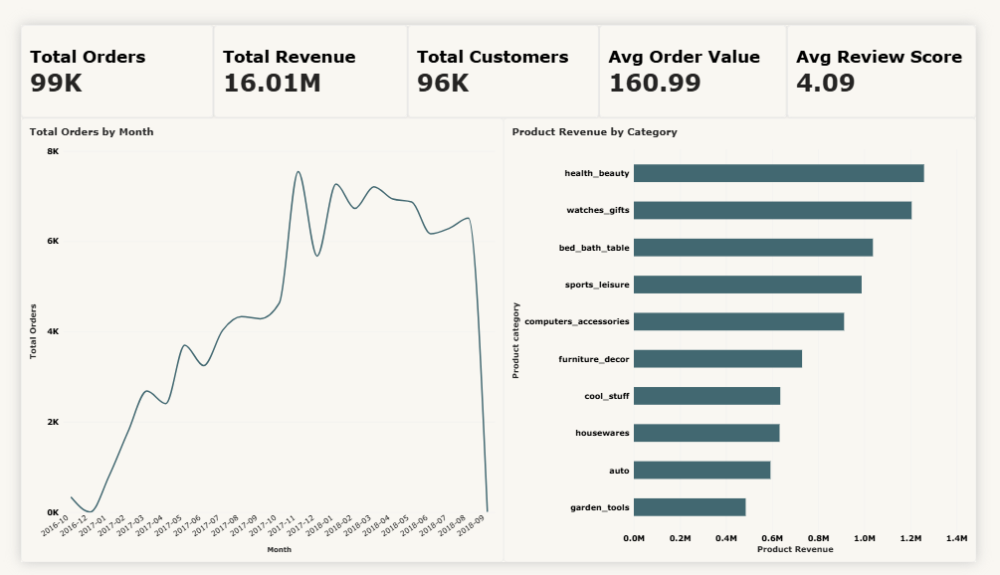

# E-Commerce Analytics — Olist Dataset

End-to-end data analytics project analyzing **100K+ orders** from the Brazilian E-Commerce Public Dataset (Olist). Covers the full analyst workflow — from raw CSV to SQL database, business queries, and an interactive Power BI dashboard.

## 📊 Power BI Dashboard

An interactive 3-page dashboard built on this dataset.

**Pages:**
- **Executive Overview** — KPIs, monthly trends, top categories
- **Customer Analytics** — Geographic distribution, repeat customer analysis
- **Operations Analytics** — Delivery performance, seller analysis

**Built with:** SQL (MySQL) · Power BI · DAX · Power Query

📂 [View the full dashboard documentation →](powerbi_dashboard/README.md)

---

## 📋 Business Problem

Analyze an e-commerce dataset to uncover revenue drivers, customer behavior, delivery performance, and seller quality — enabling data-driven decisions.

## 🎯 Objectives

- Build a relational database from 9 raw CSVs
- Clean and validate 1.5M+ rows
- Write 30+ business analysis queries in SQL
- Build a 3-page Power BI dashboard for executives

## 🛠️ Tools Used

- **MySQL** — database design, cleaning, 30+ analysis queries
- **Power BI** — interactive dashboard
- **Power Query** — data transformation
- **DAX** — calculated measures

## 🗄️ Database Schema

9 tables, ~1.5M rows total:

`customers` · `orders` · `order_items` · `order_payments` · `order_reviews` · `products` · `sellers` · `geolocation` · `product_category_translation`

## 🔍 Key SQL Techniques Used

- Joins (INNER, LEFT) across 4+ tables
- Window functions (RANK, LAG, ROW_NUMBER)
- Common Table Expressions (CTEs)
- Conditional aggregation (CASE WHEN + SUM)
- Subqueries and correlated subqueries
- Date functions and month-over-month analysis
- Fan-out-aware querying (order vs payment grain)

## 📊 Key Business Insights

- **Total revenue: R$ 16.01M** across 99K orders
- **Health & Beauty and Watches** categories lead revenue
- **São Paulo (SP)** dominates customer concentration (42% of customers)
- **Only 3% of customers are repeat buyers** — major retention opportunity
- **Late delivery rate: 7.87%** — highest in remote northeastern states
- **97% of orders successfully delivered**

## 👤 Author

**Yusuf Baig** — Aspiring Data Analyst | Open to roles in Dubai, UAE
- LinkedIn: [yusuf-baig-783906210](https://www.linkedin.com/in/yusuf-baig-783906210/)
- GitHub: [@Yusufbaig2001](https://github.com/Yusufbaig2001)
